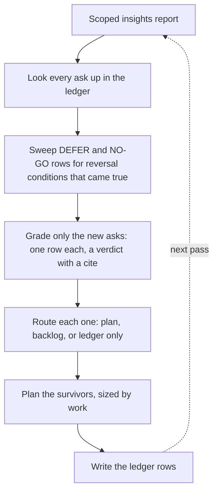

# claude-insights-loop

What to do with Claude Code's `/insights` report after the first run.

The first report is full of new ideas. From the second pass on, most of what it asks for you have
already shipped or already refused, because the report reads your session history and cannot see
your repository. Over nine passes on one repository, 62% to 69% of each pass's asks were already
decided while the work was steady. This loop turns that majority into a lookup: every ask goes
into a ledger once, each new report is checked against the ledger **before** anyone reads it, and
only the asks that survive get planned.

This is a write-up, not a tool. Nothing here is installed. You point your own Claude Code at this
repo and ask it to fit the loop to your project. The full story of the nine passes is in
[docs/nine-passes.md](docs/nine-passes.md).

## Fit it to your project

Open Claude Code in your own repository and paste:

```text
Read every file in https://github.com/BioMycoBit/claude-insights-loop (clone it to a temporary
folder): README.md, docs/nine-passes.md, .claude/commands/insights-triage.md,
ledger/insights-ledger.md, scripts/check_ledger.py and scripts/scoped_insights.py.
Then fit that loop to this repository:

1. Ask me where my plans and my backlog live (sprint docs, GitHub issues, a TODO file, something
   else), where the ledger should go, and what to call the triage command and scripts.
2. Keep every row of the README's "Keep exactly" table as written. Decide every row of the
   "Swap for your own" table with me; none of that repo's names or paths are defaults.
3. Start the ledger empty. Its example rows are someone else's decisions.
4. Before trusting the scoping script, list ~/.claude/projects and tell me which folder names
   belong to this repository. If Claude Code only ever runs in this repository on this machine,
   say so: the script is then unnecessary.
5. Show me every file you would create or change before writing any of them.
```

### Keep exactly: these make the loop work

| Rule | Why |
|---|---|
| The ledger is read **before** the report | The lookup is the point. Read the report first and you re-argue every ask. |
| Each lookup is judged by its exit code, never by empty output | A broken grep prints nothing, exactly like a clean miss. |
| One row per ask, forever; a later pass appends to that row's Pass cell | An ask raised five times is one finding and a report with no memory. |
| Four verdicts: LANDED, OPEN, DEFER, NO-GO | A fixed vocabulary is what lets a checker enforce the rest. |
| DEFER and NO-GO name the fact that would reverse them | Without it, every pass re-opens the decision from scratch. |
| Refuse with a measurement | A refusal that rests on preference loses the next time the report raises it. |
| A re-raise is not evidence; only a fired reversal condition reopens a row | The report re-raises by construction. |
| Size the plan by work, not by how many asks survived | Two asks can differ by an order of magnitude in work. Give each its own planned session. |
| Reports never enter git | They quote your session text. |

### Swap for your own: these are this repo's choices

Decide each row for your project. This repo's names and paths are examples, not defaults: copying
one unchanged, the command name included, should be a choice you made, not one you skipped.

| Choice | This repo uses | Yours might be |
|---|---|---|
| Where the ledger lives | `ledger/insights-ledger.md` | a section of an existing doc, a wiki page |
| Where plans go | `plans/insights-<date>.md` | GitHub issues, sprint docs, a TODO file |
| Command and script names | `/insights-triage`, `scripts/scoped_insights.py`, `scripts/check_ledger.py` | whatever fits your conventions |
| Where a new ask is routed | plan this pass, your backlog, or ledger only | your own destinations |
| Where reports are saved | `insights/`, gitignored | any folder git ignores |
| Scoping the report to one repo | `scripts/scoped_insights.py` | nothing, if Claude Code runs in only one repo on the machine |

## The loop



## The pieces

### The triage command: `.claude/commands/insights-triage.md`

**Why:** the steps above have to run in the same order every pass, and the order is the method.
Read the report first and the lookup never happens.

**What it does:** looks each ask up in the ledger by its headings alone, sweeps the closed doors,
grades only the surviving asks, states the already-decided share, routes each new ask, writes a
plan with one section per ask, and writes the ledger rows.

**What to change:** the two lines at its top (the ledger path and the plans location), the
routing destinations in its Step 6, and its name.

### The ledger and its checker: `ledger/insights-ledger.md`, `scripts/check_ledger.py`

**Why:** a decision that lives only in an old plan or a closed sprint costs an excavation to find
again. One table, kept forever, answers "have we decided this?" with one grep.

**What it does:** six columns (Key · Ask · Pass · Verdict · Revisit · Source). The checker refuses
an unknown verdict, a DEFER or NO-GO with no reversal condition, a LANDED with no source, and a
duplicate key. It exits 0 clean, 1 naming each broken row, 2 on misuse. Standard library only.
The example rows are real decisions from the nine passes, with their commits removed.

**What to change:** the file's location, and the column names if yours differ (keep the four
verdicts and the two refusals).

### The scoping script: `scripts/scoped_insights.py`

**Why:** a plain `/insights` reads every session on the machine, across every repository. If you
use Claude Code in more than one repository, its asks mix projects. If you do not, skip this.

**What it does:** hard links this repository's session folders into a private config folder,
points `CLAUDE_CONFIG_DIR` at it, and runs the official `claude -p /insights` there. It copies
the cached session summaries so finished analyses are not repeated, and clears up to 50
unanalysed ones per run so those get read. It refuses to start if its output folder is not
ignored by git, and refuses the report if any analysed session came from outside the repository
or if fewer sessions were listed than linked.

**Cost:** a first run analyses up to 50 sessions, and each later run up to 50 more until every
session is covered. That is Claude Code's own cap per run.

**Run it:**

```bash
claude setup-token                                    # once, in a terminal; prints a token
read -rs CLAUDE_CODE_OAUTH_TOKEN && export CLAUDE_CODE_OAUTH_TOKEN
python3 scripts/scoped_insights.py --out insights/    # the folder must be gitignored
```

The token goes through the environment because the private config folder has no login of its
own. Never pass it as an argument.

**What to change:** `is_kept_folder`, after listing `~/.claude/projects` (a folder is named after
the working directory with every character that is not a letter or digit replaced by `-`, so
worktrees and subfolders get folders of their own), and the default output folder. The docstring
at the top explains the four details that make it work.

## What nine passes taught

- **Pass 1 is an audit of what you already have.** The first report said "mechanize your rules
  with hooks", and two existing hooks turned out to have been dead for five months. Fire every
  hook before you trust it. ([Pass 1](docs/nine-passes.md#pass-1-the-advice-was-right-and-the-premise-was-wrong))
- **The report cannot see what you shipped.** Five asks on the second pass had shipped while the
  report was being generated. ([Pass 2](docs/nine-passes.md#pass-2-the-report-doesnt-know-what-you-shipped))
- **Refuse with a number, or have the argument again next month.** One ask came back on five
  passes; the refusal held because it carried a count and a named reversal condition.
  ([Refuse with a number](docs/nine-passes.md#refuse-with-a-number-or-have-the-argument-again-next-month))
- **A re-raise is not evidence. A fired condition is.** A closed row reopened when its stated
  condition came true, and two decisions reversed when a measurement moved.
  ([A fired condition](docs/nine-passes.md#a-re-raise-is-not-evidence-a-fired-condition-is))
- **Prefer a door to a sentence.** Almost every ask that landed was a mechanism that refuses the
  bad action; almost every refusal was a request for another paragraph of rules.
  ([Prefer a door](docs/nine-passes.md#prefer-a-door-to-a-sentence))
- **The ledger goes stale too.** By pass 7, four of seven OPEN rows had shipped and nothing had
  written them back. Flip a row to LANDED when its work ships.
  ([The ledger goes stale](docs/nine-passes.md#the-ledger-goes-stale-too))

## Sharing a report

Keep reports out of version control; they quote your session text, including whatever you pasted
into a session. If you want to share one, convert it to text, scrub it with your own list of
product, client and personal names, then give the scrubbed text to a fresh Claude with no tools
and no context and ask it to guess the product and the author. Anything it guesses right from a
phrase, rewrite and ask again.

## Tested on

Linux, with Claude Code 2.1.330 (`claude --version`). The scoping script's first run on a fresh
scope folder linked 381 sessions, analysed 50 of them in detail for the first time, and took 73
seconds; the report covered 281 of the 381. Both scripts are standard library only and were run
on Python 3.11. macOS and Windows are untested; the script's lock uses `fcntl`, which Windows
lacks.

## License

MIT, covering everything here, the article included. See [LICENSE](LICENSE).

This is a write-up, so it takes no pull requests. Suggestions are welcome as issues.
